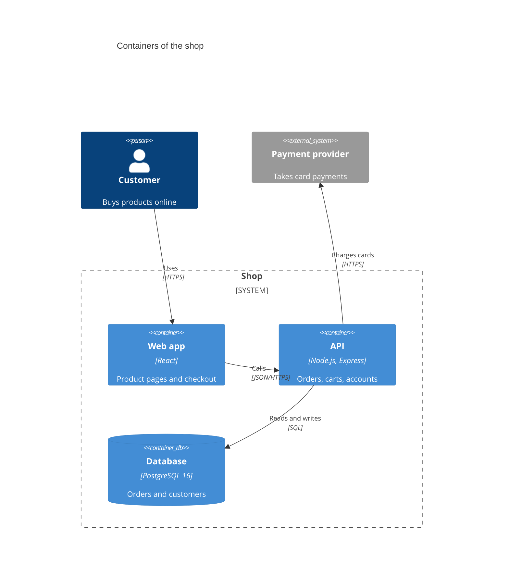

# System architecture diagrams (C4) — plan

**Status:** proposed, waiting for decisions (see the end). Nothing is implemented yet.

## Goal

A system architecture diagram shows what a system is made of and how the parts relate. It also shows the people who use it, the outside systems it depends on, and where the system's boundary is. It is the first diagram a new developer, reviewer or client should see.

omm already draws part of this. Every scan writes an `overall-architecture` perspective: a flowchart of components with labelled edges, where each component can be opened to show its own diagram.

What that flowchart doesn't show today:

| Missing | Why it matters |
|---|---|
| Users and outside systems as their own kind of element | Readers can't tell at a glance what belongs to the system and what doesn't (`:::external` only colors a box) |
| The system boundary | "Our system" vs. "theirs" is the first question in any review |
| Named levels of detail | "Which runnable parts exist" (containers) and "which modules are inside one part" (components) get mixed in one diagram |
| Technology per part | "API (Node.js, Express)" or "Database (PostgreSQL)" is the most asked-for fact on these diagrams |
| A legend | Non-technical readers need the shapes explained |

The usual way to fix this is the **C4 model**, which has four levels, each one zooming into the previous:

| C4 level | Shows | Mermaid header | omm place |
|---|---|---|---|
| 1. System context | The system as one box, its users, the outside systems | `C4Context` | new `system-context` perspective |
| 2. Containers | The separately running parts: apps, services, databases, queues | `C4Container` | `overall-architecture` |
| 3. Components | The main modules inside one container | `C4Component` | the child diagram of a container |
| 4. Code | Types inside a component | `classDiagram` (done) | a child of a component, when useful |

omm's drill-down already works like C4's zoom: a perspective → a child element → its children. So C4 fits the existing model without a new storage format.

## Options

### A. Conventions on flowcharts (no new diagram type)

- **Context level:** a new `system-context` perspective drawn as a flowchart. The system is one box. Users get a new `:::person` category, outside systems keep `:::external`.
- **Container level:** `overall-architecture` puts the system inside a `subgraph` boundary (rendered as a lane). Technology goes on the label's second line: `api["API\n[Node.js · Express]"]`.
- **Viewer:** a person shape and a legend, nothing else.

| For | Against |
|---|---|
| Small: skill rules, one category, a shape, a legend | Not the standard C4 notation; other tools won't read it as C4 |
| Every existing diagram keeps working | Technology and description are squeezed into labels |
| Flow motion and color mode work unchanged | Levels are only a naming convention |

### B. Mermaid's C4 syntax as a new diagram type (recommended)

Support Mermaid's C4 diagrams the same way as the other types, with a parser, validation, diff and a viewer renderer:

| For | Against |
|---|---|
| The standard notation; the same text renders in Mermaid, and reads like C4-PlantUML | Mermaid marks C4 as *experimental*; its syntax may still change |
| Kind of element, technology and description are separate fields, so they can be checked | Larger: parser, renderer, rules (about the size of the class diagram work) |
| Levels are explicit (`C4Context` / `C4Container` / `C4Component`) and can be validated | Mermaid's own C4 layout is weak; ours uses dagre, so positions differ from mermaid.live |
| Boundaries are part of the syntax | |

**Recommendation: B.** It is the same choice made for deployment (Mermaid's `architecture-beta` rather than flowchart conventions), and the diagram type exists precisely for this purpose. The "experimental" risk is limited: we parse the documented macros only, and unknown macros are reported, not guessed. `C4Deployment` stays out of scope, since `architecture-beta` already covers deployment.

## Design (option B)

### What gets parsed

| Kind | Macros | Stored as |
|---|---|---|
| People | `Person`, `Person_Ext` | element `person`, `external` flag |
| Systems | `System`, `SystemDb`, `SystemQueue` and their `_Ext` forms | element `system` with shape `box` / `db` / `queue` |
| Containers | `Container`, `ContainerDb`, `ContainerQueue` and `_Ext` | element `container`, with `technology` |
| Components | `Component`, `ComponentDb`, `ComponentQueue` and `_Ext` | element `component`, with `technology` |
| Boundaries | `Boundary`, `Enterprise_Boundary`, `System_Boundary`, `Container_Boundary` with `{ … }` | nested groups |
| Relationships | `Rel`, `BiRel`, `Rel_U/D/L/R` (and long forms), `Rel_Back`, `RelIndex` | edge with `label`, `technology`; direction suffixes as layout hints |
| Other | `title`, `UpdateElementStyle`, `UpdateRelStyle`, `UpdateLayoutConfig` | title kept; style and layout read and ignored (as Mermaid's own renderer partly does) |

- **Parameters:** both positional (`Container(api, "API", "Node.js", "Orders")`) and named (`$descr="…"`, `$techn="…"`) are read. `sprite`, `tags` and `link` are read and ignored, since Mermaid doesn't support them either.
- **Errors** carry line numbers:
  - unknown macros;
  - unclosed boundaries;
  - relationships to undeclared aliases;
  - duplicate aliases.

### Validation (`omm validate`)

| Rule | Level | Checks |
|---|---|---|
| `c4-syntax` | error | Anything the parser could not read |
| `c4-level` | warning | An element that doesn't belong at the diagram's level. Examples: a `Component` in a `C4Context`, or a container diagram without any container. Following the C4 model's own guidance |
| `c4-rel-label` | warning | A relationship without a label. C4 requires every relationship to say what it does |
| `c4-technology` | warning | A container or component without a technology |
| `c4-orphan` | warning | An element with no relationships |
| `node-count`, `secret-value`, `@ref` rules | as today | Elements counted are people, systems, containers and components |

### Diff (`omm diff`)

- **Nodes:** aliases.
- **Edges:** `from --> to: label [technology]`.
- **Fields:** a changed technology or description is reported as a member change (`api.technology`), the same way class members are.

### Viewer

- **Shapes:**
  - a person with a head and body;
  - boxes for systems, containers and components, with the name, `[Technology]` and the description;
  - cylinders for `Db`, and a pipe shape for `Queue`;
  - external elements get a dashed border, not just a different color.
- **Boundaries** are dashed boxes labelled with their name and kind (`[System]`).
- **Relationships** are drawn as arrows with the label and `[technology]`. `BiRel` gets two arrowheads, and the `_U/_D/_L/_R` hints choose the main direction, the same way architecture-diagram sides do.
- **Monochrome and color:**
  - Monochrome follows the existing look.
  - Color uses the familiar C4 meanings, checked for contrast in both themes like every other role: person dark blue, internal system/container blue, component light blue, external grey.
- **Flow motion:** relationships are interactions (requests, messages), so with **flow** on, one-way relationships move, as in architecture diagrams. `BiRel` stays still. *Decision 3.*
- **Legend:** a small key in the corner listing only the element kinds that appear, toggled with **clean**. Exported SVG/PNG include it, so a slide explains itself.
- **Click-through:** elements whose alias matches a child element open it. This is how `system-context` → `overall-architecture` → container → component navigation works.

### `/omm-scan`

- **New perspective `system-context`** (`C4Context`), written for every project that has users or outside systems.
  - Its evidence: README and docs, entry points (HTTP routes, CLI commands, UI), and outbound integrations in code (HTTP clients, SDKs, queues).
  - `omm evidence deployment` already lists hosted services and environments.
- **`overall-architecture`** for new scans is a `C4Container` diagram when the project has more than one running part (*decision 2*). A single library or CLI keeps today's flowchart, because one container would be an empty level.
- **Components** are the child diagrams of containers, as `C4Component`.
- **Rules:**
  - every relationship has a label and, when known, a technology;
  - technologies come from files (`package.json`, Dockerfiles, lock files), never guessed;
  - people and outside systems come from code or docs, never invented;
  - 5–15 elements per diagram.
- **Links:**
  - Containers link to `deployment` services by source path, with the same `%% @…` comment rule as deployment.
  - Components link to the code-level `type-hierarchy` diagrams when they exist.

### Compatibility

- Existing `overall-architecture` flowcharts keep working and keep rendering exactly as today. Nothing is migrated automatically.
- A re-scan may write a `C4Container` instead. `omm diff` would then show the change as removed and added nodes, because the diagram type changed. The design doc and changelog will say so.
- No new dependency. No change to `.omm/` storage.

## Plan (stacked PRs, same pattern as the other types)

| # | PR | Contents | Tests |
|---|---|---|---|
| 1 | C4 parser, validate, diff | `src/lib/c4.ts`; `detectDiagramType` → `c4`; rules above; diff | Fixtures for context, container and component levels; named and positional parameters; boundaries nested 3 deep; every error with line numbers; level warnings; diff of technology changes |
| 2 | Viewer | `renderC4Group`: shapes, boundaries, relationships, legend, color roles, flow motion, export | Headless Chrome on all three levels in both themes and both color modes; strict-XML export; flow icons on path and in direction; legend in the export; contrast tests for the new roles |
| 3 | `/omm-scan` and this repository | `system-context` perspective; C4 rules; `overall-architecture` guidance; this repo's own `system-context` (omm as one system, with the developer, the AI coding tools, GitHub, npm and the optional cloud API) | `omm validate` clean; rendered in the viewer; links to `deployment` resolve |
| 4 | Docs | design doc, roadmap, changelog, five READMEs, `omm-view` legend note | — |

**Size estimate:** about the same as the class diagram work. The parser is a little simpler, since it is macro calls only; the renderer is a little larger, because of the person shape and the legend.

## Acceptance criteria

- `C4Context`, `C4Container` and `C4Component` diagrams written in Mermaid's syntax validate and render in the viewer. Unsupported macros are reported with line numbers, not dropped silently.
- People, internal and external systems, containers, components, databases and queues look different in monochrome too, not only in color.
- Every relationship shows its label and, when given, its technology. Boundaries are visible and labelled.
- The legend explains every shape on the diagram and appears in SVG/PNG exports.
- `/omm-scan` writes a `system-context` perspective grounded in files and code. Technologies and outside systems are never invented, and unknowns are listed in `note`.
- Existing flowchart `overall-architecture` perspectives render exactly as before.
- Tests, type check and build pass. Rendering is checked in headless Chrome in both themes.

## Risks

| Risk | Mitigation |
|---|---|
| Mermaid changes its experimental C4 syntax | Parse only the documented macros; report unknown ones; note the Mermaid version in the design doc |
| Diagrams render differently in mermaid.live (grid layout) and omm (dagre) | Same elements, same relationships; positions differ, as with architecture diagrams |
| The AI invents users or outside systems | Rules require evidence per element; `note` lists what was inferred; unverified relationships are labelled `(unverified)` |
| Level confusion (components in a context diagram) | `c4-level` warning |

## Decisions needed

1. **Notation:**
   - **a (recommended):** Mermaid C4 syntax as a new diagram type (option B).
   - **b:** flowchart conventions only (option A).
2. **`overall-architecture` in new scans:**
   - **a (recommended):** a `C4Container` diagram when there is more than one running part, otherwise today's flowchart.
   - **b:** always keep the flowchart, and add only `system-context`.
3. **Flow motion on C4 relationships:**
   - **a (recommended):** one-way relationships move, as in architecture diagrams.
   - **b:** C4 diagrams stay static.
4. **This repository:**
   - **a (recommended):** write omm's own `system-context` as the real-world check.
   - **b:** fixtures only.
